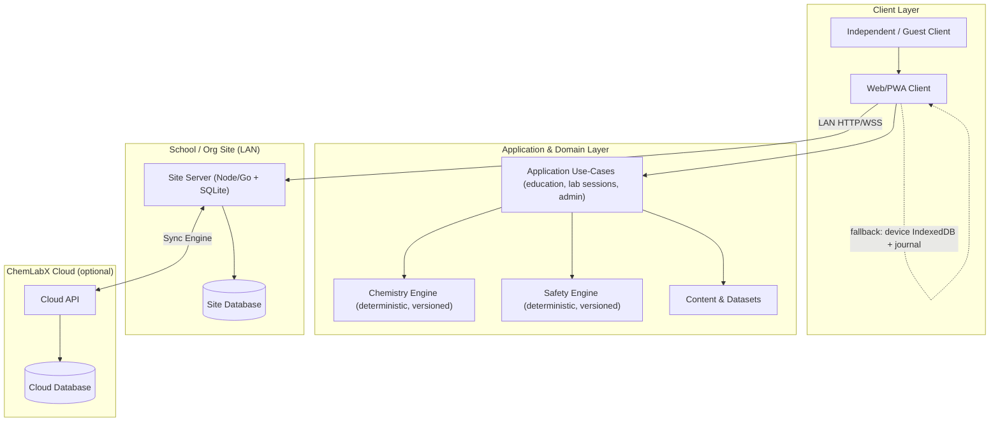
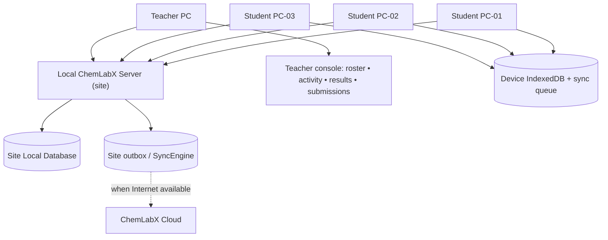
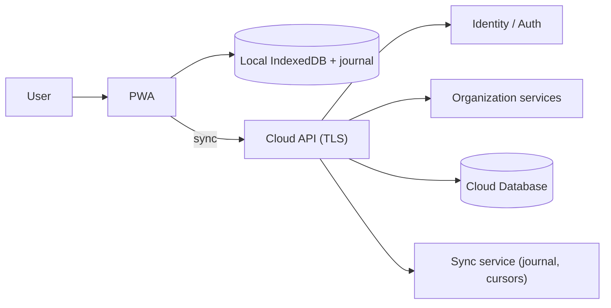
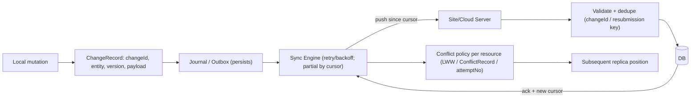
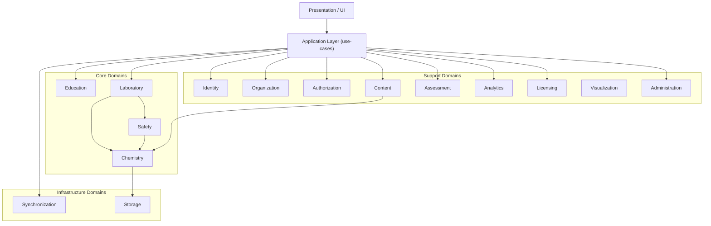
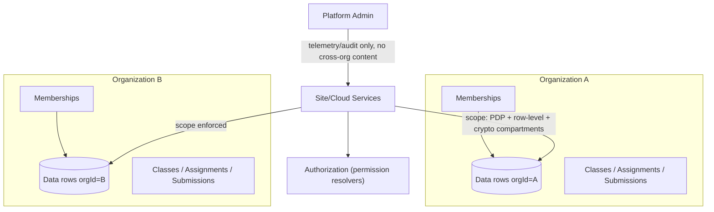
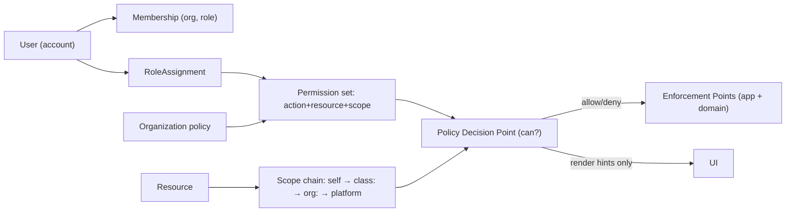
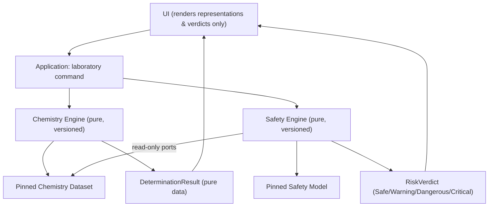
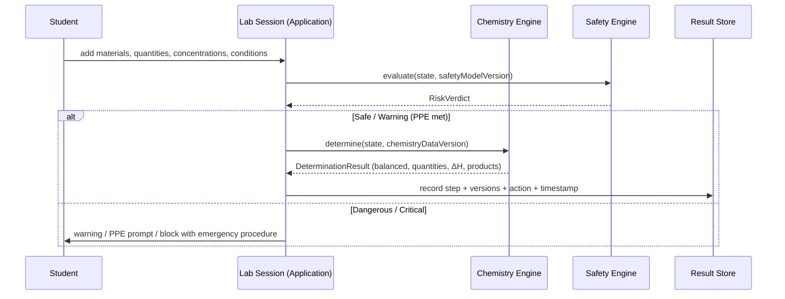
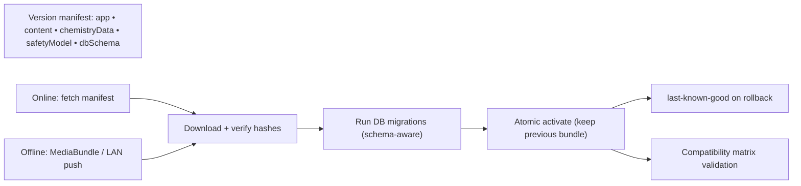

# ChemLabX Pro — Target System Architecture

**Document:** CHEMLABX_ARCHITECTURE.md
**Task:** TASK-002 — Architecture Options, Comparison & Recommended System Architecture
**Status:** Architecture design only. No implementation, no application-code modification, no deletion/rename, no dependency installation.
**Related input:** `AUDIT_REPORT.md` (previous audit of the existing ChemLabX 4.0 prototype).
**Audience:** Architects, implementers, and the decision-holders listed in §30.

**Implementation status (post-TASK-011):** this document defines the **target** architecture. The on-device foundation path it introduced (storage/provenance, chemistry/lab/safety domains, validated chemistry data, versioned content, authorization, the Sync Foundation / Change Journal, and the Education Domain Foundation) has been delivered incrementally by **TASK-003 → TASK-011** (migration-map rows in §21, the §28 next-task list, and the additive §31 delivery note carry delivery annotations). Everything else — Site Server, Cloud, Sync Engine transport, production identity, the broader Education feature set beyond the TASK-011 foundation (provisioning/import, gradebook/assessment, analytics dashboards), org multi-tenancy — remains **deferred future work gated on the open §26 human decisions**, which remain open (MUST-DECIDE #1 chemistry-accuracy bar, #2 school scenario / Site Server priority, #4 backend language, #5 cloud ownership, #6 student-data ownership).

**Current verified state:**
- Version pins: `SCHEMA_VERSION=2`, `CHEMISTRY_DATA_VERSION='validated-v1'`, `CONTENT_VERSION='content-v1'` (bound to the content manifest), `APP_VERSION='4.0.0-foundation'`.
- Dataset counts: **185 unique materials · 28 validated reaction keys · 14 experiments · 6 lessons · 20 quiz questions** (`content-v1`, schemaVersion 2, contentHash present).
- **`validated-v1`** = the dataset passed the project's deterministic/schema/data-validation requirements (de-duplication, canonicalization, cross-references, fail-closed against the engine). It is **NOT** blanket expert certification, academic/laboratory certification, or a guarantee that every chemistry fact has been independently expert-reviewed. Expert academic review remains a separate product-quality requirement (§26 MUST-DECIDE #1).
- **`content-v1`** = the current versioned educational-content release. It does **NOT** imply a complete production curriculum, completeness for every edition, or expert certification of lesson/quiz content beyond what the content validator verifies (pack versioning, schema, locales, experiment↔reaction referential integrity).
- **TASK-009** delivered **authorization hardening** (centralized fail-closed authorization, privileged-mutation protection, registration self-escalation closure, current-user hardening) — **NOT** production authentication/identity (no MFA, OAuth/SSO, protected password-reset, identity-provider integration, or complete session-security architecture; the §18.1 prototype auth posture remains).
- **TASK-010** delivered the **Sync Foundation / on-device Change Journal Foundation** (ChangeRecord schema, per-entity versioning, idempotent append, cursor/replay/ack, tombstones, fail-closed validation, local persistence) — **NOT** a complete Sync Engine, Site Server, Cloud synchronization, network transport, conflict-resolution runtime, CRDT, or multi-organization synchronization (§13).
- Regression baseline: `test/validate_{chemistry,content,authorization,changejournal}.py` all **PASS**; `test/verify.ps1` = **143 PASS / 0 FAIL** in all four harness contexts (10/10 pages, 0 runtime errors, offline Service Worker intact, TASK-011 Education K-suite included).
- **Roadmap status:** TASK-003 → TASK-011 **COMPLETE** · **no TASK-012 was started** (TASK-011 §32 hard stop).

---

## 0. Reading Guide & Non-Goals

This document defines the **target architecture** for ChemLabX: a serious virtual chemistry laboratory and chemistry-education platform for School / Institute / University / Professional / Independent / Guest levels.

**Non-goals of this document (and of this task):**
- It does NOT implement anything (no Chemistry Engine, Safety Engine, Sync Engine, auth infrastructure, UI redesign).
- It does NOT rewrite the prototype.
- It does NOT choose a specific UI framework on popularity.
- It does NOT assume permanent Internet access. **Offline-first is a hard requirement.**

A companion set of diagrams is published as Mermaid sources under `docs/architecture/`.

---

## 1. Architectural Requirements

Derived from the product vision and the audit (§1, §21 of `AUDIT_REPORT.md`):

| # | Quality | Meaning |
|---|---|---|
| R1 | Offline-First | All core education + lab flows must work with zero connectivity from cold start. |
| R2 | Online-Capable | The same client enhances with connectivity; no data model change. |
| R3 | Local-Network Capable | Multi-PC classroom operation over a LAN with no Internet (school scenario). |
| R4 | Cloud-Sync Capable | Bidirectional, safe, explainable data convergence when connectivity appears. |
| R5 | Multi-Organization | Strict tenant isolation between schools/institutes/universities. |
| R6 | Multi-Edition | One codebase; configurable School / Institute / University / Professional editions. |
| R7 | Extensible | New chemistry domains, visualization, AI, content scale without rewrites. |
| R8 | Scientifically Defensible | Chemistry outcomes come from deterministic, validated, versioned systems. |
| R9 | Safety-First Education | Danger is taught, handled, and (optionally) simulated — never rewarded. |
| R10 | Local-First Autonomy | Every node (device, site server, cloud) can fail without killing the others. |
| R11 | Reproducibility | A saved experiment can later be reconstructed byte-for-appropriate semantics. |
| R12 | Versioned Everything | App, content, chemistry data, safety model, DB schema all versioned. |

**Boundary constraint (from the vision):** AI may assist learning but must **never** be the source of chemical truth or safety decisions.

---

## 2. The School Offline Scenario (design driver)

```
                    SCHOOL LAN (no Internet)
                             │
                     ┌───────┴───────┐
                     │               │
              Local ChemLabX     Teacher PC
                 Server              │
                     │               │
              ┌──────┼──────┬────────┘
              │      │      │
            PC-01  PC-02  PC-03
           Student Student Student
```

Required behaviors, all **without Internet**:

- Students log in (credential verification must work offline, against a local store).
- Students run experiments, complete assignments, save results locally.
- The teacher sees **live activity, experiment results, and submissions** via the LAN server.
- The teacher creates assignments and reviews submissions.
- Classes behave normally (rosters, join codes, grading).
- When Internet appears, the **school site** synchronizes with ChemLabX Cloud (new site → cloud, and administrative/update material cloud → site).

This scenario is impossible with a cloud-centric design and painful with per-device-only storage (§6). The architecture therefore places a **local authority node** (Site Server) at every organization site, with per-device autonomy as the fallback.

---

## 3. Architecture Options — Comparison & Recommendation

### 3.1 Architecture A — Pure PWA + Local Device Storage

Each browser is a self-contained node; all data lives in that device's IndexedDB.

**Advantages**
- Zero on-site infrastructure; runs on anything modern.
- Maximum offline independence; survives network and server failures completely.
- Private to the device; simple; matches the current prototype (already localStorage-based).
- Trivially cheap; no IT staff, no backup duties (per device).
- Deploy anywhere that serves static files.

**Disadvantages**
- **No teacher visibility** of student work unless the teacher physically uses the same device/browser.
- **No classroom collaboration**: rosters, assignments, and submissions cannot be aggregated on the LAN.
- **No central identity**: each device is its own identity silo; shared classroom PCs create chaos (whose account/browser is this run on?).
- **Sync requires a self-built out-of-band channel**: the PWA alone cannot move data between devices; you must add a server/peering anyway.
- Data is hostage to one device — loss on reset/cleanup; no backup story.
- Administrative control, licensing enforcement, and org isolation impractical device-side.

**Security:** local-origin boundary only; identity is weak; no central audit.
**Maintenance:** device fan-out multiplies problems; every device must be updated.

### 3.2 Architecture B — PWA + Local School Server + Cloud

Clients are PWAs; a **Site Server** runs on the school LAN (Raspberry Pi / mini-PC / old desktop); the site server owns the local database and syncs bidirectionally with Cloud when reachable. Clients talk to the Site Server over HTTP/WebSocket on the LAN, and can fall back to device-local mode if the server is unreachable.

**Advantages**
- **Full offline classroom** behavior: logins, activity, submissions, teacher monitoring all live on the LAN.
- **Teacher visibility** is natural (server aggregates class state).
- One place for **backup, rosters, licensing, updates** (server pushes app/content updates to clients).
- Handles **shared PCs** cleanly (accounts live server-side, or server-issued device keys).
- **Clean migration** from the prototype: device storage layer is swapped first; server added later as a pure peer with sync.
- Scales from 1 PC (server = same PC) to an institute rack without architectural change.

**Disadvantages**
- Requires one maintained machine per site (power, updates, occasional IT help).
- The LAN server is a single point (mitigated by device-side queues and fallback local mode).
- Sync complexity is *real* (versioned journal, conflicts on teacher-edited resources).
- On-prem software means licensing/compliance considerations (see §13, §22).

**Security:** server mediates authentication and scopes data by org; stronger than A.
**Maintenance:** centralized; one server is cheaper to keep healthy than N devices.
**Scalability:** per-site scale is trivial; multi-site scales via cloud broker (or per-org servers), not by growing one server.

### 3.3 Architecture C — Cloud-Centric + Offline Cache

All authority, storage, and logic in the cloud; browsers keep a shell + optimistic queue.

**Advantages**
- Single source of truth; global analytics; cross-school licenses easy.
- Least school IT burden; data always centrally backed up.
- Uniform enforcement of editions/RBAC/licensing.

**Disadvantages**
- **Fails the school-with-no-Internet requirement**: offline is degraded, not full.
- Teacher monitoring requires connectivity to the classroom; unreliable on WAN-only schools.
- Optimistic queues create **conflict hotspots** (many devices editing shared class data).
- **Data ownership** sits with the cloud operator — often unacceptable for school contracts.
- Latency undermines the lab experience; recurring running cost; vendor lock-in.
- Offline-only schools simply cannot participate.

**Security:** centralized is easier to police, but it concentrates risk and depends on trust in the operator.

### 3.4 Required comparison table

Legend: ★★ strong · ★ adequate · ☆ weak/absent.

| Requirement | Architecture A (PWA + device) | Architecture B (PWA + site server + cloud) | Architecture C (cloud-centric) |
|---|---|---|---|
| Full offline | ★★ (device-local only) | ★★ (whole classroom on LAN) | ☆ (degraded cache/queue) |
| School LAN | ☆ (none) | ★★ (native) | ☆ (depends on WAN) |
| Teacher sees students offline | ☆ (only same device) | ★★ (server aggregation) | ☆ (needs WAN) |
| Student collaboration | ☆ (absent) | ★ (shared class store) | ★ (central, if online) |
| Cloud sync | ☆ (must be built ad hoc) | ★★ (designed-in journal) | ★★ (native) |
| Data safety | ☆ (per-device loss) | ★ (central backup + device queues) | ★★ (cloud) |
| Scalability | ★★ (but siloed) | ★ (per-site; cloud for multi-site) | ★★ (pure scale) |
| Maintenance | ☆ (device fan-out) | ★ (one server per site) | ★★ (operator-managed) |
| Security | ☆ (device-only) | ★ (server-mediated, org-scoped) | ★★ (if fully centralized) / ★ (offline tails) |
| Cost | ★★ (zero infra) | ★ (one cheap machine) | ☆ (per-seat cloud + bandwidth) |
| Deployment | ★★ (pure static) | ★ (needs installable server package) | ★ (big-bang migration, WAN dependence) |
| Multi-school | ☆ (none) | ★★ (per-site servers + cloud broker) | ★★ (one platform) |
| Future growth | ☆ (architecture dead-ends) | ★★ (extendable: engs, orgs, AI) | ★ (scale, but captive to WAN) |

### 3.5 Recommendation

**Architecture B — PWA + Site Server + Cloud** — is the recommended backbone.

**Not** chosen for simplicity: it is chosen because it is the only option that satisfies all four pillars simultaneously — full offline classroom operations (§R1/R3), teacher visibility (§R2), later cloud sync (§R4), and multi-org scale (§R5). Architecture A cannot deliver teacher visibility or collaboration; Architecture C cannot deliver offline classrooms at all.

The **recommended architecture is B refined to be "node-optional"** (see §4): a standalone device degenerates to A automatically (no site server reachable → device-local mode with queued sync), and a connected site adds cloud services opportunistically — so C's benefits attach to B whenever online. This layered autonomy is the single most important design decision.

---

## 4. Recommended Architecture (Overview)

```
                     CHEMLABX PLATFORM
                            │
                     Client Applications (Web/PWA)
                            │
                            │   Standard device-local store + sync queue
                            │
              ┌─────────────┴─────────────┐
              │                           │
        Local mode (A)               Site Server (B) —— LAN
              │                           │
              └─────────────┬─────────────┘
                            │
                     Application Layer
                            │   use-cases, workflows, session orchestration
              ┌─────────────┼─────────────┐
              │             │             │
          Education     Laboratory      (Administration,
          (classes,      │                Licensing, Content)
          assignments)   │
              │      ┌────┴────┐
              │   Chemistry   Safety
              │    Engine     Engine
              └──────┴────┬────┘
                         │  deterministic, versioned, validated
                    Domain Services
                            │
              ┌─────────────┼─────────────┐
              │             │             │
         Local Storage   Local Server    Cloud API
         (IndexedDB)      (SQLite)       (Cloud DB)
              │             │             │
              └─────────────┼─────────────┘
                            │
                         Sync Engine
                     (identity, journal, cursors, conflict policy)
```

**Layers, in dependency order (upper → lower); arrows point "depends on":**
1. **Clients** — PWA app running the full offline experience.
2. **Application Layer** — education & lab use-cases; owns session/task orchestration; may use local *or* site *or* cloud data through one `DataPort` interface.
3. **Domain Services** — Chemistry Engine, Safety Engine, Content, Assessment, Analytics, Visualization adapters (pure logic, UI-free).
4. **Storage & Sync** — Storage abstraction (IndexedDB/SQLite adapters), versioned datasets, sync journal, transport (LAN HTTP / cloud HTTPS / import-export media bundles).

**Key property:** every layer is *replacable* and *deployable* on either the device, the site server, or the cloud, because logic is bound by **interfaces (ports)** and data by **schemas**, not by concrete modules.

---

## 5. Domain-Driven Architecture — Bounded Domains

All domains are **capabilities**, not directories; they may live in one codebase (modular monolith) at site scale, and split later only if monitoring proves need. Dependencies are `top-of-diagram → bottom`; cross-edges are forbidden except via Application Layer.

| Domain | Responsibility | Main entities | Depends on | MUST NOT depend on |
|---|---|---|---|---|
| **Identity** | Credentials, account lifecycle, device trust, sessions, recovery | Account, Credential, DeviceKey, Session, ResetCode, LoginFactor | Storage, Sync, (AuthZ) | Organization, Education, UI |
| **Organization** | Tenant lifecycles, membership, org config, org scoping | Organization, Membership, OrgRole, OrgSettings, OrgScopeKey | Identity, Authorization | Education internals, Chemistry, UI |
| **Authorization** | Permission atoms, role resolution, scope checks, PDP/registry | Role, Permission, Scope, Policy, RoleAssignment | Identity, Organization | UI rendering details |
| **Education** | Roster, classes, curriculum objects, assignments flow | Teacher, Student, Class, Course, Lesson, Assignment, Submission | Identity, Organization, Authorization, **Content** | Chemistry engine internals, Safety internals, UI |
| **Laboratory** | The virtual lab session; orchestration of equipment, materials, procedures, recordings | LabSession, Equipment, BenchItem, Procedure, Observation, Measurement, ResultRecord, Notebook | **Chemistry** (for computations), **Safety** (for gating), Storage | UI, rendering libs |
| **Chemistry** | Validated chemistry knowledge & determination; versioned datasets; engine | Element, Compound, Molecule, Material, Property, Reaction, StoichCoeff, Condition, DeterminationResult | Storage (read datasets), own `ChemistryDataVersion` | **HTML/DOM, UI, Visualization renderers, Safety internals** |
| **Safety** | Hazard knowledge, state evaluation, risk verdicts, rules, incidents | Hazard, HazardClass, GHSClass, Compatibility, ExposureRisk, RiskAssessment, SafetyRule, PPEReq, EmergencyProcedure, IncidentRecord | **Chemistry** (material/quant data, read-only), Content (rules), Storage | UI, Visualization renderers, Education internals |
| **Visualization** | Molecular/equipment rendering adapters, 2D now, 3D later | MolRepresentation, GeometryAdapter, Renderer (2D/3D), ViewConfig | **Chemistry** (representation, read-only) | Engine algorithm internals; must not be depended on by Chemistry |
| **Content** | Versioned catalog & authored content (lessons, quiz items, datasets manifests) | ContentPack, ContentItem, ContentVersion, DatasetManifest, Locale | Storage, Licensing (for editions) | Lab/engine internals |
| **Assessment** | Scoring rules, grading, rubrics | Rubric, ScoreSpec, Assessor, GradeRecord, Feedback | Education, Content | Safety, Chemistry internals |
| **Analytics** | Anonymous/org-aggregated learning telemetry | EventStream, Metric, Report | Education, Organization (privacy) | UI |
| **Licensing** | Editions, features, entitlements | License, Edition, FeatureFlag, OrgPlan, Entitlement | Organization, Identity | UI, engines |
| **Synchronization** | Change journal, cursors, conflict policy, transports | ChangeRecord, ReplicaPosition, ConflictRecord, SyncQueue, MediaBundle | Storage, Identity (for auth) | UI, engines |
| **Storage** | Schema-versioned persistence across IndexedDB/SQLite/Cloud | StoreAdapter, Transaction, SchemaVersion, MigrationRecord | — | UI, engines (engines read via repository ports) |
| **Administration** | Platform & org admin workflows, audit | AuditLog, AdminTask, OrgRegistry, FeatureOverride, IncidentBoard | Organization, Identity, Licensing, Analytics | Education/UI specifics |

**Attention pairs (must stay decoupled):**
- **Chemistry ↔ UI:** UI → Application → Chemistry (commands in, results out as pure data). Chemistry must never touch DOM, `document`, or a renderer (§21).
- **Safety ↔ UI:** Safety → verdict data; UI renders it. Safety never renders warnings itself.
- **Chemistry ↔ Safety:** Safety reads Chemistry's data (materials, quantities) via read-only ports; Chemistry never imports Safety verdicts to compute a reaction.

---

## 6. The Chemistry Domain (design-only)

### 6.1 Conceptual model

```
Experiment 1:N ProcedureStep
Experiment 1:N MaterialUse (Material* + amount + unit + concentration)
Experiment 1:N EquipmentUse (Equipment* + setting)
Experiment 1:N Condition (temperature, pressure, pH, time, atmosphere)
Experiment 1:N Measurement (measurand* + value + unit + uncertainty + instrument)
Experiment 1:N Observation (phenomenon* + qualitative note + timestamp)
Experiment 1:1 Result (derived quantities, reaction outcomes, yield, ΔH, ...)
```

Domain entities (names descriptive; not a data contract):

- **Element** — atomic identity: atomicNumber, symbol, name(loc), atomicMass, group/period, properties.
- **Compound** — formula, name, structural hints, state at STP, lattice/normal properties.
- **Molecule** — structural representation (atoms, bonds, coordinates — domain-neutral), IUPAC + registry identifiers.
- **Material** — the *practical* substance: Compound/Molecule + state, purity, form, default concentration; maps to physical inventory ("Sodium metal", "0.1 M HCl").
- **ChemicalProperty** — measured/derived properties (density, solubility, ΔHf, Ka…), each with source + uncertainty + value-set version.
- **Reaction** — balanced equation, Reactants/Products with **StoichiometricCoefficient**, conditions, mechanism hints, enthalpy/entropy (validated), references.
- **ReactionCondition** — T, P, concentration window, solvent, catalyst, atmosphere constraints.
- **Experiment** — a runnable/recordable procedure bound to a dataset version (§18).
- **ProcedureStep / Measurement / Observation / Result** — the recorded execution record (§19 reproducibility).

### 6.2 What belongs in the Chemistry domain

Reaction balancing, stoichiometric computation, quantity/mole bookkeeping, equilibrium/kinetics templates (only when validated), determination engine outputs. **Everything about "what is chemically true".**

### 6.3 What belongs elsewhere

- **Education:** the assignment that wraps an experiment, the grade.
- **Laboratory:** the interactive session, the bench layout, tool state machines, the log.
- **Safety:** whether the experiment may be run.
- **Visualization:** how a molecule is drawn.
- **Content:** the lesson text that explains the chemistry.
- **Assessment:** scoring the student's explanation.

The Engine exposes: `determine(sessionState, datasetVersion) -> DeterminationResult` — pure function, no side effects, no UI, no randomness (or seeded RNG → recorded).

---

## 7. The Safety Domain (design-only)

> **Implementation status (TASK-005):** A minimal **prototype Safety boundary** now exists at
> `js/domain/safety.js` (`window.Safety.evaluate`, `RULES_VERSION`). It is deterministic,
> UI-free, fail-closed, and consumes only `Laboratory.normalizeState(...)` output plus the
> `DeterminationResult` from `Chemistry.determine(...)` (via read-only ports — never a direct
> `reactions`/`materialDB` lookup). It uses the existing **prototype** `materialDB[].state` and
> `reactions[].danger` fields only as non-authoritative inputs and stamps
> `SAFETY_MODEL_VERSION`/`SAFETY_RULES_VERSION = 'prototype-rules-v1'`. Nothing below is
> implemented beyond that thin, prototype gate; the full entity model remains design-only.

### 7.1 Evaluation pipeline

```
Laboratory state:
   Materials + Quantities + Concentrations
 + Temperature + Pressure + pH
 + Environment (ventilation, emergency kit)
 + Equipment (type, integrity)
 + Procedure (what steps are planned)
        │
        ▼
   Safety Evaluation (deterministic, versioned safety model)
        │
        ├── Safe        (allowed; standard precautions)
        ├── Warning     (allowed with PPE / cautions)
        ├── Dangerous   (restricted; gating, explanations, PPE mandatory)
        └── Critical    (blocked; emergency procedure surfaced)
```

### 7.2 Entities & boundaries

- **Hazard** — a hazard *instance* exposed by a material/process (e.g., "Na + H2O → H2 (flammable) + exotherm").
- **HazardClass / GHSClassification** — statutory classes (per validated GHS table, versioned), labels, pictograms (content, not UI).
- **PPERequirement** — enforced before execution in `Dangerous` states.
- **ChemicalCompatibility** — pairwise/template compatibility verdicts from validated tables.
- **ExposureRisk** — concentration/quantity-dependent exposure bands (vapour, contact).
- **RiskAssessment** — a saved evaluation record: inputs, verdict, reasons, version.
- **SafetyRule / EmergencyProcedure / IncidentReport** — content objects used to *teach* and to gate.

### 7.3 Boundary rules (echoed into every safety-critical design)

1. Deterministic: same input → same verdict for the same safety-model version.
2. Read-only on Chemistry: consumes Material/Reaction data; never mutates it.
3. UI-free: returns a verdict data structure.
4. **Fail closed:** unknown material, unknown quantity, unknown compatibility → `Dangerous`/`Critical` (never `Safe`).
5. **Educational framing:** verdicts carry "what happens / why / conditions / how to handle / emergency" content; **no reward value is attached to danger** (§32).

---

## 8. The Education Domain

```
Organization
   ├── Teachers (memberships + org role)
   ├── Classes
   │      ├── Students (enrollment membership)
   │      └── Assignments (lesson / experiment / quiz; due dates; targets)
   │            └── Submissions (per student) ──► Assessment (grade, feedback)
   └── Organization Settings (edition, features, defaults, privacy)
```

Teacher capabilities (target):
- Create/manage classes; enroll/unenroll students (codes + manual + import).
- Assign experiments, lessons, quizzes (from versioned Content + Experiment catalog).
- See live/queued submissions and **experiment results** (measurements, log, safety verdicts encountered).
- Track activity/attempts/errors; review mistakes; view per-student and per-class progress dashboards.

Relationships with the **Laboratory** domain: an Assignment of type `experiment` wraps an `Experiment TemplateKey` + conditions; the LabSession produced while performing it becomes a `Submission` payload (result payload + notebook + versions, §18–19).

---

## 9. Multi-Tenancy (design-only)

- **Tenant = Organization.** Every cross-organization object carries `orgId` (and class-scoped `classId` where applicable). Tenant identifiers are opaque, non-sequential.
- **Tenant isolation layers:**
  1. **Data scoping:** every table/index keyed by `orgId`; storage adapter enforces scope on every query; no un-scoped repository methods reach production.
  2. **Service isolation:** Application & domain services take `Scope(orgId, userId, roleScope)` on entry; scope validated against Identity/Authorization.
  3. **Transport/credential isolation:** sync payloads are tenant-coded; a device/site belongs to exactly one org (with a personal-org for independent users).
  4. **Optional crypto compartments:** org-controlled secrets may encrypt org data at rest; even the cloud operator cannot read (PII-compliant schools).
  5. **Multi-tenant test lanes:** seed/manifest checks assert "Org A cannot read Org B" (contract tests).
- **User membership** is `(account, org, role)`; a user may belong to many orgs but each session picks an active `orgId`.
- **Organization administrators** manage memberships/roles/licensing within their org only.
- **Platform admin** sees operational telemetry but **not** plain-text cross-org content (least privilege + audit).

Mermaid: `docs/architecture/06-multi-tenant.mmd`.

---

## 10. Edition Model (single codebase)

```
ChemLabX Core  (one product)
     ├── School Edition
     ├── Institute Edition
     ├── University Edition
     └── Professional Edition
```

- **Edition** — a named configuration entry point (UI polish, defaults, feature set profile).
- **FeatureFlag** — a capability id (e.g., `lab.hazards.advanced`, `assessment.rubrics`, `analytics.department`, `content.advancedOrganic`).
- **License** — a signed entitlement document (org-scoped): `{orgId, edition, plan, issuedAt, expiresAt, featureWhitelist, signature}`.
- **OrganizationPlan / Entitlement** — resolved per-org sets of FeatureFlags.
- **Mechanics:** one artifact tree; a `FeatureService.isEnabled(orgId, feature)` gate (with **server-side enforcement** where the capability is server-resolvable — never client-only for licensing). Editions are *profiles over flags*, not separate projects. Content catalogs and engines read via the same ports; only flag-gated subsets are exposed per edition.

---

## 11. RBAC — Scalable Authorization

**Model: Roles → Permission-set; Permission = (action, resource-type, scope).**

- **Roles (default soft-set, org-configurable):** PlatformAdmin, OrganizationAdmin, Teacher, Student, Expert, SafetyOfficer, Researcher, Guest. Orgs may omit roles (a small school may lack SafetyOfficer/Researcher).
- **Scope levels:** `platform`, `org:<id>`, `class:<id>`, `self`. Permission examples:
  - `assignment:publish:class:<id>`
  - `submission:read:class:<id>`
  - `submission:read:self`
  - `lab:operate:self`
  - `experiment:results:read:class:<id>`
  - `org:settings:update:org:<id>`
- **Resolution:** `can(user, action, resource) = exists(RoleAssignment(user,org,role)) ∧ role→permission ∈ org policy ∧ permission.scope ⊇ resource.scope`. Resource "scope chain": resource → class → org → platform.
- **Enforcement points:** Application Layer validates every mutation; domain services re-validate on entry (defense in depth); UI merely renders what the same PDP allows (UI never *is* the policy).
- This replaces `if (user.role === 'teacher')` checks: roles remain as *etiquettes for UX*, while **permissions (+scope +membership +ownership)** carry authority.

Mermaid: `docs/architecture/07-rbac-model.mmd`.

---

## 12. Offline Data Model (critical)

### 12.1 Storage engine comparison

| Engine | Pros | Cons | Verdict |
|---|---|---|---|
| **IndexedDB (browser)** | Native to all targets incl. PWA; large quota; indexes & transactions; works on every modern browser; no build | Async API ergonomics (wrap it); no SQL; cross-tab coordination manual | **Primary device store** |
| SQLite (WASM/OPFS browser) | Full SQL; mature; same SQL as server | WASM bundle size; OPFS/partition quirks; heavier for small devices | Optional later for analytics-heavy clients |
| Local embedded server DB (SQLite on site server) | Full SQL; ACID; backup/restore; one file | Needs the site node | **Site server store** |
| Web Storage (localStorage) | Trivial | ~5 MB, string-only, lossy — the current prototype uses this | Rejected (migrate from, see §25) |

### 12.2 What lives locally (device)

Chemistry/expe content *cache*, experiment templates, lessons/questions cache, the **student's session data**, settings.

### 12.3 What lives on the site server

Authoritative org data: accounts, rosters, assignments, submissions aggregate, results, audit; content/update distribution authority; site-level backup.

### 12.4 Synchronized data (device ↔ site ↔ cloud)

The **user/org data plane**: submissions, results, progress, assignments, membership deltas. Content is *distributed*, not synced (one-way, versioned, replaceable — no conflicts). Chemistry datasets/safety models are *distributed content* too (versioned packages), not per-user mutable data.

### 12.5 Schema-versioned storage

Every store ships a `schemaVersion`; migrations run onboard (device IndexedDB) and on server at upgrade, never mid-flight. Rule: **a store must never silently change shape** — read the version, migrate, then open.

---

## 13. Synchronization Engine (design-only)

### 13.1 Model

- **Change journal:** every mutating action appends `ChangeRecord { changeId (UUID), entityType, entityId, baseVersion, version, op (upsert/delete), payload, wallClock, deviceId, actorId, orgId }`.
- **ReplicaPosition (cursor):** each replica tracks the highest applied `version` per entity/stream; replicas exchange `cursor + changes since cursor`.
- **Transports:** LAN HTTP/WebSocket to Site Server; HTTPS to Cloud; **MediaBundle** (file/QR) for air-gapped import/export of queued changes.
- **Idempotency:** `changeId` dedupe prevents double-apply; submissions also keyed `(studentId, assignmentId, attemptNo)` to block duplicates.
- **Retry:** per-change retry with exponential backoff; queue persists; partial sync resumes from cursor (bulk by shard).
- **Failure semantics:** any transport failure is non-fatal (queue holds); replicas never block local operations waiting on sync.

### 13.2 Conflicts: detection & policy (per domain policy)

- **Preferred:** avoid by **single-writer-per-resource** assignment (a LabSession is written solely by its student + engine; a GradeRecord only by teacher/auto-assessor). Most education data already converges cleanly.
- **Detected** via version comparison / field tombstones on multi-writer resources (org settings, assignment edits).
- **Resolution policy table:**

| Resource | Writer(s) | Conflict policy |
|---|---|---|
| LabSession / Result / Notebook | Student (+ engine) | Last-write-wins per change stream, merge of observation list by `changeId` |
| Submission | Student; server | First-apply idempotent; later edits = new `attemptNo` (never merge grades) |
| GradeRecord | Teacher (or auto) | LWW per grade field with **ConflictRecord** surfaced for review if crossed |
| Assignment | Teacher (single org site) | LWW at site; Cross-org edits flagged rather than merged |
| Membership | OrgAdmin | Explicit `ConflictRecord` → admin inbox, no auto-merge |
| Settings | OrgAdmin / Platform | LWW by scalar field, audit-trail both sides |
| Content carries | Platform (one-way) | No user conflicts: version-gated replace |

### 13.3 Concrete workflow (school)

```
Student completes experiment offline
        ↓  lab session recorded locally (dataset/en engine/safety versions stamped)
        ↓  Internet unavailable → changes enter local journal
        ↓  Sync queue (device → LAN server) healthy on LAN: changes flow to site server
        ↓  Teacher sees submission on LAN immediately
        ↓  Internet restored for site server
        ↓  Site server pushes queued changes to Cloud; server acks by cursor
        ↓  Site ↑ cloud; cloud ↓ site (administrative bundles, entitlement refresh)
```

**Empty-run guarantee:** the *student↔site* hop is the offline-critical one and is always available on the LAN; *site↔cloud* is best-effort.

---

## 14. Data Ownership

| Data | Owner | Notes |
|---|---|---|
| Chemistry dataset, safety model, engine, core app, content IP | **Platform (ChemLabX)** | Versioned; licensed to orgs (§13, §18); orgs may not redistribute |
| Organization record, settings, membership, classes, assignments policy, audit | **Organization** | Org admins govern; platform operates under contract |
| Class structure & assignment *instances* | **Teacher within org** | Org retains access rights; teacher edits until publish |
| Experiment session, notebook, measurements, personal progress | **Student** | Student owns the artifact; org has access via membership (privacy policy required); platform never reads plain (crypto-compartment option, §9) |
| Submission & its grade | **Joint student/org** | Visible to student, teacher, org admin; assessor records why |
| Busines/usage analytics | **Platform (anonymized)** / **Org (org-scoped)** | Never keyed to a student outside org consent |

Ownership drives **licensing** (Platform IP), **deletion policies** (student export/erase rights), and **sync permissions** (who may move what between tiers).

---

## 15. Chemistry Data Versioning & Reproducibility

### 15.1 Versioning

- **DatasetManifest:** `{ datasetId, version (semver), schemaVersion, schemaHash, contentHash, publishedAt, provenance (sources/reviewers), editions }` — every scientific lane gets one:
  - `chemistry-data` (elements/compounds/materials/properties/reactions)
  - `safety-model` (hazard classes, compatibility, exposure, PPE rules)
  - `content` (lessons/quizzes/experiment procedures)
- Lookups are always performed **against a pinned dataset version**; a pinned version is immutable (published forever).

### 15.2 Reproducibility contract

A saved **ExperimentResult** embeds enough to reconstruct the run:

```
ExperimentResult
   ├─ chemistryDataVersion  (pinned dataset manifest hash+semver)
   ├─ engineVersion         (chemistry determination engine build)
   ├─ safetyModelVersion    (safety model build)
   ├─ contentVersion        (experiment template/procedure version)
   ├─ schemaVersion         (result payload schema)
   ├─ inputs: materials(id, amount, unit, concentration) X equipment(setting)
   ├─ conditions: T, P, pH, time, atmosphere
   ├─ procedure: ordered steps (each with timestamp + snapshot of state)
   ├─ actionSequence: every user action (add, mix, heat, stir, observe…) w/ wall-clock
   ├─ engine inputs/outputs per step (deterministic; seeds recorded if any)
   └─ accountability: actorId, deviceId
```

Reproduction = re-run the action sequence through the *same pinned versions* → identical result; if versions differ, the UI *states* the version delta. This is the guarantee that makes results **scientific** rather than anecdotal.

---

## 16. AI Boundary

**Allowed (advisory only):**
- Explain (what the deterministic engine returned, paraphrasing it), teach concepts, summarize, suggest next steps, search content, help the student *understand an error*, generate educational questions.

**Forbidden (authoritative only):**
- Deciding chemical equation truth, safety classification, hazard severity, experimental results, scientific measurements. These come solely from the **validated deterministic systems** (§6–§7).

**Communication contract:**

```
UI/Coach (AI assistant)
   │ asks (natural language, elaborate)         ── advisory path ──►
   ▼
AI Proxy layer  →  deterministic Knowledge/Engine APIs (read-only)
   │              returns fact-quotes with citations + provenance
   ▼
labels every AI claim as "AI-generated, non-authoritative";
never routes student → AI for a safety verdict (must go to Safety Engine);
never lets AI mutate state or datasets.
```

The AI layer therefore *quotes* authoritative services (so provenance stays attached) and cannot override them. Safety verdicts are displayed from the Safety Engine only; AI may then explain *the verdict's meaning* re-stated, verbatim-attributed.

---

## 17. 3D / Visualization Architecture

```
Chemistry Data (domain)
      ↓ implements / produces
Molecular Representation   (domain-neutral: atoms, bonds, coordinates, radii, charges)
      ↓
Visualization Adapter interface   (contract: build scene from representation)
      ├── 2D Renderer (canvas/SVG — today)
      └── 3D Renderer  (future: Three.js/WebGPU peer-implementing the adapter)
```

- The **Chemistry Engine depends only on the Representation**, producing geometry-contract data; it must never import Three.js or know about canvases/DOM.
- **Future 3D** = a second `Adapter` implementation behind the same contract; the engine and data are untouched. Existing decorative canvas effects (`particles.js`/`effects.js`) remain a *display effect*, not visualization, and must be labeled honestly.

---

## 18. Security Architecture

### 18.1 Prototype vs Production posture

| Concern | Prototype (current) | Target (this architecture) |
|---|---|---|
| Authentication | localStorage, weak service-side only | Offline-capable credential verification (device keychain); online: token-based sessions |
| Password storage | djb2-style reversible hash | Argon2id (server) / PBKDF2-derived local key; salted; never reversible |
| Sessions | localStorage object | Short-lived opaque token + refresh; per-device registration; expiry & revocation |
| Tokens | — | Signed, aud-iss-sub-scope claims; rotate; single-active-session policy per role where needed |
| Organization isolation | none | Tenant-scoped queries + row-level + optional crypto compartments (§9) |
| API security | none | TLS everywhere (LAN self-signed CA or mTLS); rate limit; replay protection via changeId |
| Input validation | ad-hoc | Schema-contract validation at every boundary (app + domain + storage) |
| XSS | innerHTML + partial `esc()` | CSP, no raw innerHTML with untrusted data, framework-safe escaping, output encoding |
| CSP | absent | Strict CSP with nonces on production bundles |
| Audit logs | none | Append-only org+platform audit stream (who/what/when/from; changeId-ed) |
| Local data at rest | plain JSON | Encrypt sensitive local data via Web Crypto (org-derived key), key never in plaintext; media bundles signed |
| Device trust | none | Device registration per user (pairing code via teacher/org admin on first login) |
| Teacher authorization | self-serve | Enrolled by org admin or invitation; permission-scoped, not role-checked |
| Student enrollment | open code | Pairing + class membership before org data access |

**Guiding rule:** device offline ≠ insecure. Offline nodes enforce the same PDP locally (with the org's policy bundle), then sync their decisions/actions for server audit.

---

## 19. Update Architecture

**Five independent version lanes:** `appVersion`, `contentVersion`, `chemistryDataVersion`, `safetyModelVersion`, `dbSchemaVersion`.

| Lane | Change trigger | Distribution |
|---|---|---|
| app | client/server code | online: manifest fetch; offline: MediaBundle / LAN push |
| content | authored packs | same; orgs may freeze to a content version |
| chemistryData / safetyModel | validated release | **immutable pinned**; clients may run older pins; safety model upgrades add capabilities with forward compatibility |
| dbSchema | storage shape | migrations run device & server at open (never mid-flight) |

**School online:** check manifest → staging (download bundle) → verify hashes → apply DB migrations → activate (atomic swap) → rollback on error to *last-known-good version set* (keep previous bundle).
**School offline:** an administrator brings an update **MediaBundle** (e.g., USB) or the Site Server pushes to LAN clients; the Site Server is the offline update authority. No device ever updates beyond its schema-compatible set (Compatibility matrix: app ↔ dbSchema ↔ datasets ↔ safety model per version).
**Concepts explicit:** version negotiation (never downgrade silently), migration records, compatibility descriptors per release, staged/delta updates for bandwidth-poor sites.

---

## 20. Deployment Models

| Model | Setting | Infrastructure | Offline requirement |
|---|---|---|---|
| **M1 — Personal** | Independent user / guest | Browser PWA + device IndexedDB (+ optional cloud for backup when online) | Full |
| **M2 — School** | School LAN, no Internet | **Site Server** (mini-PC/Raspberry Pi; Node/Go binary+SQLite) + N client PWAs; optional cloud sync | Full on LAN |
| **M3 — Institute/University** | Organizations, departments, many classes | Org Site Server (or VM) + multiple departments **on one tenant**, per-dept classes; optional cloud | Full on campus LAN/VPN |
| **M4 — Professional/Expert** | Dedicated, research-grade | Cloud (or dedicated host) deployment + advanced chemistry/safety/analytics add-ons under Professional entitlement; desktop-class local engine still available offline | Full core; rich features online |

Migration M1→M2→M3 is **data-plane compatible**: same sync journal, same org scoping; M3 uses one tenant with structural divisions (dept → class), M4 adds features via edition flags, not architectural changes.

---

## 21. Current Prototype Migration Map

**Status of this map:** the foundation-path rows below were **delivered by TASK-003 → TASK-010** (storage adapter + IndexedDB migration, provenance stamps, fail-closed reaction path, validated chemistry dataset, versioned content packs with manifest, authorization hardening, Change Journal). The deferred rows (Site Server / Cloud / Sync Engine transport, Identity upgrade, Education/admin refactors) remain future work gated on the §26 decisions. See the status note in §0 and `docs/architecture/POST-TASK-010-RECONCILIATION-AUDIT.md` for the delivered-vs-deferred breakdown.

**Rule:** never rewrite for its own sake. Existing modules already encapsulate ideas (audit §18) — adapt them to the layered architecture. Guide mapping `CURRENT → TARGET`:

| Current | Target | Class |
|---|---|---|
| `js/core/db.js` (localStorage) | Storage adapter `DataPort` → IndexedDB adapter (+ later SQLite/cloud) → sync-capable journal | **ADAPT** (keep `CHLDB` API; swap store; add journal) |
| `js/core/auth.js`, `pages/auth.js` | Identity + Authorization domains (PDP, device keys, sessions) | **REFACTOR** |
| `js/core/i18n.js`, `ui.js` | Content locale pack + UI layer (unchanged behavior) | **KEEP/ADAPT** |
| `js/data/materials.js` | Versioned Chemistry dataset (schema + manifest + validation; duplicate keys removed — 185 unique at `validated-v1`) | **REBUILD** |
| `js/data/reactions.js` | Validated Reaction dataset + Chemistry Engine data contract; **fail-closed unknowns** | **REBUILD** |
| `js/data/achievements.js` | Education gamification policy — stripped of any danger-reward; behind entitlement | **REFACTOR** |
| `js/lab/engine.js` | Split: Laboratory Application (director) + Chemistry Engine (deterministic) + Safety Engine (gates) | **REBUILD** |
| `js/lab/lab.js`, `bench.js`, `shelf.js` | Laboratory domain: LabSession orchestration, bench/shelf as UI adapters | **ADAPT/REFACTOR** |
| `js/lab/particles.js`, `effects.js` | Display effects (honest naming; `prefers-reduced-motion`) | **KEEP** |
| `js/pages/dashboard.js` | Education modules (role views split by use-case) | **REFACTOR** |
| `js/pages/admin.js` | Administration/org domain (scoped, audited) | **REFACTOR** |
| `js/pages/lessons.js`, `quiz.js` | Content domain (versioned JSON/Markdown packs) | **REBUILD** |
| `js/pages/experiments.js`, `profile.js`, `landing.js`, `auth.js` | App Layer pages over ports | **ADAPT** |
| `sw.js` + `manifest` | Distribution: keep; add update negotiation, offline fallback, version lanes | **ADAPT/REFACTOR** |
| Legacy dead files: `js/app.js`, `js/data.js`, `js/quiz.js`, `css/style.css` | Remove after content is ported to the versioned model | **REMOVE** |

Path example:

```
localStorage (db.js)        js/lab/engine.js             js/data/materials.js          dashboard.js
      ↓                            ↓                           ↓                            ↓
Storage abstraction          Laboratory Application       Versioned Chemistry         Education / App
      ↓                            +                        Dataset (manifest+      domain modules
      ↓                       Chemistry Engine             schema+validation)
IndexedDB / Local DB              + Safety Engine                 ↓
      ↓                                                                    (pinned
Sync-capable store                                                        versions)
```

---

## 22. Technology Decision

**Front-ends (client):**

| Option | Advantages | Disadvantages | Offline/PWA | Long-term & learning |
|---|---|---|---|---|
| Vanilla ESM (today's) | Zero build, maximum reach, matches prototype | Repeated patterns; large-maintain cost as domains grow | Perfect (no framework in PWA) | Learning cheap; but slow to scale internally |
| TypeScript (incremental, with light build) | Type safety at domain boundaries (Chemistry/Safety contracts!), refactor safety | Build step; TS learning | Same PWA; bundle slightly larger | Pays off exactly where this product's correctness risk lives |
| React / Vue | Component ecosystem, dev speed for complex UI | Runtime cost on low-end school PCs; framework churn; larger PWA | Viable via bundlers | Bigger maintenance surface |
| Svelte | Small runtime, good DX | Smaller ecosystem; team familiarity needed | Great PWA fit | Modern but niche |

**Recommendation (client):** **stay Vanilla ESM today; introduce TypeScript incrementally for the domain/engine cores (Chemistry, Safety, Sync)** where contracts and correctness pay the highest dividends. Adopt a DOM framework only when UI componentization demonstrably costs more than it saves (decision §30 "CAN LATER"). Rationale — not popularity: the school scenario prizes reach + low-end-device performance + zero-build offline updates; correctness risk concentrates in domain code, which profiteers most from static typing.

**Back-end / local & cloud servers:**

| Option | Advantages | Disadvantages | Fit |
|---|---|---|---|
| **Node.js (TypeScript)** | One language with client domain models; mature sync/websocket; quick iteration | JS runtime perf for heavy compute; needs runtime install | Strong; recommended baseline |
| **Go** | Single static binary (ideal install for school mini-PCs); great concurrency; no runtime | Different language from client; slower content-domain coding for JS team | Excellent for the Site Server binary distribution; needs toolchain split |
| Python | Rich science ecosystem (NumPy/SciML) | Packaging & perf for servers; GIL | Good for future analytics/AI services, weak as sync core |
| .NET | Strong typing, enterprise | Heavy footprint for school LAN | Overkill for current scope |

**Recommendation (back-end):** **Node.js + TypeScript** as the primary implementation for Site Server & Cloud,** because sharing domain models (and the sync journal types) with the client is the decisive factor**; **Go** is the documented fallback if single-binary offline install becomes a hard requirement (e.g., Raspberry Pi field trialing) and the team accepts a dual language. Python stays in the AI/analytics periphery only.

**Databases:** SQLite everywhere possible (device browser store via adapter; site server; cloud PV of choice with org-scoped schemas). PostgreSQL only when cloud analytics/scale mandates it. **No 'Mongo-first'** — relational constraints protect education data integrity.

---

## 23. Architectural Principles (≥15)

1. **Offline First** — every feature must be designed to run from cold with zero connectivity.
2. **Local Autonomy** — a node must never depend on another node's availability for its own operations.
3. **Fail Closed** — unknown data/un-known compatibility/unknown dataset → deny or `Dangerous`, never silently assume safe.
4. **Scientific Determinism** — same pinned versions + same inputs ⇒ same results; seeded randomness only, recorded.
5. **Version Everything** — app, content, datasets, safety model, DB schema; immutability for published scientific versions.
6. **Data Provenance** — every result carries dataset/engine/safety/content versions and sources.
7. **Reproducibility** — a saved experiment can be re-executed semantically identically (§15.2).
8. **Separation of Concerns** — UI ↔ Application ↔ Domain ↔ Storage with strict dependencies.
9. **Domain Isolation** — Chemistry, Safety, UI never import each other's internals (§5).
10. **No UI Dependency in Domain Logic** — engines return data; renderers consume representations (§17).
11. **Single Source of Truth** — one authoritative store per data type per scope; everything else is cache/queue.
12. **Least Privilege** — permissions are atomic, scoped, resolved at enforcement points.
13. **Security by Design** — authz, CSP, input validation, audit built-in, not bolted on.
14. **Audit Everything That Matters** — append-only logs for authoritative/safety decisions and org admin actions.
15. **Backward Compatibility** — schema-compatible updates; pinned versions keep old results valid.
16. **Testability** — domain cores are pure functions over ports: deterministic, fuzzable, contract-tested.
17. **Extensibility Over Innovation** — add domains via new adapters/ports, not by editing engines.
18. **Tenant Isolation by Construction** — scope keys on every repository path; contract tests prove leaks absent (§9).
19. **Data is the Product** — validated content and clean provenance is the moat; guard its integrity.
20. **Safety-Teaching, Not Entertainment** — danger is educative and gated; never rewarded (§32).

---

## 24. Required Final Architecture Diagrams

Embedded Mermaid for each; standalone sources in `docs/architecture/`.

### 24.1 High-Level System Architecture


### 24.2 School Offline Architecture


### 24.3 Online Cloud Architecture


### 24.4 Sync Architecture


### 24.5 Domain Architecture


### 24.6 Multi-Tenant Architecture


### 24.7 RBAC Model


### 24.8 Chemistry/Safety Boundary


### 24.9 Experiment Execution Flow


### 24.10 Update / Versioning Flow


---

## 25. Decision Matrix

| Decision | Options | Recommended | Reason | Confidence |
|---|---|---|---|---|
| Frontend architecture | Vanilla ESM / TS ESM / React / Vue / Svelte | **Vanilla ESM now; TypeScript for domain cores incrementally** | Reach + low-end device perf + zero-build offline; correctness benefit of TS is in Chemistry/Safety/Sync | Medium |
| Backend architecture | None / Node(TS) / Go / Python / .NET | **Node.js + TypeScript (primary); Go fallback for single-binary site package** | Shared domain models & journal types with client dominate; Go if offline install drives | Medium |
| Local server | None / Node / Go / embedded in device | Same as backend; Node(TS) or Go **site server with SQLite** | One maintainable process; offline authority node (§2) | Medium |
| Database | SQLite / Postgres / MongoDB | **SQLite everywhere (site + cloud v1); Postgres when analytics scale needs** | Relational integrity for education data; tiny deploy surface on school hardware | High |
| Offline storage | localStorage / IndexedDB / SQLite-WASM | **IndexedDB through a Storage adapter (migrate from localStorage)** | Quota/transactions/indexes; matches PWA; future SQLite optional | High |
| Sync strategy | Per-device export / versioned journal / CRDT-everything | **Versioned change journal + cursors + per-domain conflict policy (mostly single-writer)** | Predictable, auditable, idempotent; CRDTs only where truly collaborative (none required now) | Medium |
| Authentication | Local-only / server tokens / OAuth | **Offline-capable credential verification (device keychain) + online token sessions** | Schools must log in without WAN; online path adds revocation | Medium |
| Authorization | role-if / RBAC / permission+scope+PDP | **Permission atoms + scopes + membership + PDP at app & domain** | Scales across 8+ roles and multi-org without scattered `if role` logic | Medium |
| Multi-tenancy | single-org / orgId-scope / crypto compartments | **orgId everywhere + row-level scoping + optional org crypto compartments** | Leak-proof by construction; privacy-optional for schools | High |
| Content storage | JS literals / JSON / Markdown packs + manifest | **Versioned content packs (JSON/Markdown) with manifests + locale** | Replaces hard-coded lesson/quiz strings; enables distribution & update lanes | High |
| Chemistry engine boundary | inline in lab / domain service / separate process | **Domain service, pure functions, pinned datasets, no UI** | Determinism, testability, reproducibility (§6) | High |
| Safety engine boundary | flags / domain service | **Domain service, read-only over Chemistry, fail-closed, versioned model** | Educational safety must be rigorous and deterministic (§7) | High |
| 3D technology | none / immediate Three.js / adapter-first | **Adapter-first (2D now, contract for 3D later); honest labeling; no engine coupling** | Future-proof without rewriting engine (§17) | High |
| AI integration | none / authoritative / advisory-proxy | **Advisory proxy quoting deterministic services; non-authoritative label** | Vision requires assistance; truth/safety stay deterministic (§16) | High |
| Deployment | pure static / +site server / cloud-only | **M1 device mode + M2 site server + M1→M4 via edition flags & sync** | Satisfies offline schools, orgs, experts from one backbone (§20) | High |

---

## 26. Human Decisions

### MUST DECIDE NOW
1. **Chemistry data accuracy/validation bar** — who guarantees the dataset/safety model (expert review? sources? lab verification), and release cadence. Blocks Phase-1 of migration (audit §24.1).
2. **School scenario priority** — confirm Site Server is required (vs pure device mode for v1); this drives backend & packaging.
3. **Danger-gamification** — confirm removal of the danger-rewarding achievements (audit §9, §24.4) and the "danger = educative, gated" rule (§32) as product policy.
4. **Backend language** — approve Node/TS primary + Go fallback (§22), which sets the build/repo decisions.
5. **Cloud ownership** — does ChemLabX Platform operate the Cloud tier, or is it per-org self-host optional? Affects licensing/sync.
6. **Student-data ownership & privacy policy** — org visibility of student work; export/erase rights; encryption compartments (§9, §14).

### CAN DECIDE LATER
- Exact 3D framework (adapter makes it swappable).
- AI providers & model choice (proxy boundary is fixed now).
- Analytics granularity & reporting UI.
- Edition/licensing mechanics (contract format, pricing lanes) — design exists.
- Fine-grained org structure (departments vs flat classes, M3).
- Deployment packaging (installers, Docker images) — architecture neutral.
- Content/catalog scale-up cadence and authoring workflow.
- Migration safety-net details (rollout for shared school PCs).

### SHOULD NOT DECIDE YET
- Micro-services split of the site server (modular monolith is correct until load proves otherwise).
- Specific CRDT library or per-entity replication protocol details.
- Specific CSS/design-system framework choice.
- ML model (beyond the advisory guarantee).
- Postgres/cloud-DB vendor specifics (SQLite first; Postgres when scale shows need).
- Blockchain/DLT or token-based incentive mechanics (out of scope). *Included for completeness — avoid.*

---

## 27. FINAL ARCHITECTURE RECOMMENDATION

> **One architecture: an edge-first, node-optional system.** A **PWA client with full local autonomy** (IndexedDB + versioned data + change journal) that upgrades to a **per-site local server (Site Server: Node/TS or Go + SQLite)** on the school LAN, and opportunistically syncs through a **Sync Engine** to a **ChemLabX Cloud** — all over one set of domain ports, editions as feature flags over a single core. (Architecture B refined with A as device mode and C's benefits when online.)

1. **Why it fits schools** — the Site Server makes classrooms fully functional on the LAN with zero WAN: logins (offline-verified), rosters, assignments, submissions, teacher monitoring.
2. **Why it works offline** — every tier has local authority and a persistent journal; no operation blocks on connectivity; content/datasets ride versioned bundles.
3. **Why teachers can monitor students offline** — the Site Server aggregates class state continuously on the LAN; the teacher console reads live activity, results, and submissions without any cloud.
4. **Why it can synchronize later** — the change journal, cursors, idempotent change IDs, and per-domain conflict policy are designed in from the start; cloud sync is just another transport.
5. **Why it supports institutes/universities** — one tenant per org, with structural divisions (dept → class) and role/permission scaling; M3 runs the exact same codebase.
6. **Why it supports expert users** — Professional edition entitlement adds advanced chemistry/safety/analytics features via flags, not new apps; local engine still runs offline.
7. **Why it avoids separate codebases** — one core + feature-flag editions + one sync/data plane; editions are configurations (§13).
8. **Why it can support future chemistry accuracy** — pinned, immutable, validated datasets + pure deterministic engine + versioned results (§15) make accuracy an *upgrade path*, never a rewrite.
9. **Why it can support a real Safety Engine** — Safety is a first-class deterministic domain (read ports over Chemistry, fail-closed, versioned model) positioned to gate any lab state (§7).
10. **Why it can support future 3D** — visualization is an adapter over a domain-neutral representation; 3D is a second renderer implementation, the engine untouched (§17).
11. **Why it can support AI safely** — AI is a quoted advisory proxy that can only *explain* deterministic outputs and can never produce truth or safety verdicts (§16).
12. **Why it can evolve commercially** — licensing/editions/entitlements are built into the model; org data ownership and cloud options create a deployment ladder from free personal mode to paid institution/professional tiers without forking.

---

## 28. NEXT IMPLEMENTATION TASK

> **Task TASK-003 — "Foundation Layer: Ports, Schema-Versioned Storage, and Data Provenance"** (derived from §4, §12, §15, §21 of this document). *Do not start it in this task; implement as a follow-up.*

**Status: DELIVERED.** The §28 foundation task was implemented as **TASK-003**, followed by **TASK-004 → TASK-010** (chemistry/laboratory/safety domains → result records → dataset validation & counts → versioned content → authorization hardening → Sync Foundation/Change Journal), and **TASK-011** delivered the Education Domain Foundation (see the additive §31 note). **No TASK-012 has been started** — TASK-011 §32 requires a hard stop.

**Goal:** keep the current prototype fully runnable while preparing the ground every later domain depends on.

**Scope (implementation follow-up):**
1. **Storage adapter:** implement `DataPort` (same API shape as `CHLDB`) with an IndexedDB adapter; keep `CHLDB` as the compatibility front end. Migrate the existing localStorage collections on first open with a recorded `dbSchemaVersion` + migration runner. *Do not touch any page logic.*
2. **Version manifest & provenance stamps:** introduce `APP_VERSION`, `SCHEMA_VERSION`, and stamp every stored LabSession/Result with `chemistryDataVersion`, `engineVersion`, `safetyModelVersion` placeholders (records available today as `contentVersion`), §15.
3. **Content packs:** move lesson/quiz/experiment catalogs into versioned JSON packs under the same `ContentVersion` mechanism (keep current JS modules as loaders during transition).
4. **Fail-closed reaction path:** alter `findReaction`'s `'default'` fallback into an explicit `unknown-result` state (UI: "not in the validated dataset") — §8/audit R2. Behavior change: avoid fabricating plausible answers.
5. **Safety rule conformance:** remove danger-reward achievements (audit §9) and re-point achievement logic to *safety-compliant* milestones; record the policy change in release notes.
6. **Cleanup:** remove dead legacy files once content is ported (audit §19): `js/app.js`, `js/data.js`, `js/quiz.js`, `css/style.css`.

**Acceptance:** prototype pages still work offline from cold start; all data survives migration; every saved experiment carries version stamps; unknown mixes fail closed; no danger rewards; zero legacy dead-code references. **Non-goals:** no new engines, no sync implementation, no UI redesign, no backend service yet (Site Server is a later phase once sync journal types are proven on device).

---

## 29. Safety Rule Compliance (educational, not entertaining)

This architecture treats every dangerous outcome as a **learning object**, not a reward: Safety Engine gates with warnings/PPE/emergency procedures; unknown states fail closed; verdicts carry "what/why/conditions how to handle/emergency"; analytics watch *understanding* (safe performance, correct procedures, measured accuracy), never danger count. Requirements R9 and principle #20 are binding for any future feature.

---

## 30. Deliverables

- `CHEMLABX_ARCHITECTURE.md` — this document.
- `docs/architecture/01..10` Mermaid diagram sources (see folder).
- No application code, configuration, or data was modified; no dependencies were installed.

---

## 31. Delivered State — TASK-011 Education Domain Foundation (additive status note)

> Additive delivery note. The target architecture above is unchanged. Where this section and the design text differ, **this section describes the shipped prototype foundation only**.

**Module:** `js/domain/education.js` — UI-free, offline-first, deterministic; exposed as `window.Education` and `CHL.education`.

- **Rules version:** `RULES_VERSION = 'prototype-education-v1'`; `ENTITY_TYPES = teacher, student, course, class, assignment, submission`.
- **Identity stays as-is:** Teacher/Student are **profiles** keyed 1:1 to an existing `CHLDB.users` record by `user.id`. No new account system, login, provisioning, or import.
- **Storage:** profiles/courses reuse the existing `CHLDB` keys (`teachers`, `students`, `courses`); Class / Assignment / Submission **reuse the existing** `classes` / `assignments` / `submissions` collections, keeping page-compatible fields and adding domain-only fields. No new database and no schema break.
- **Lifecycle:** archive-only (`active|archived`; assignments `draft|published|archived`; submissions `submitted|returned`). No destructive deletes. `entityVersion` starts at 1 and increments on mutation. `orgId` is always `null`; non-null input is **rejected** (no org semantics are fabricated).
- **Authorization:** no new permission atoms. The existing canonical roles (`admin|teacher|student|user`) are re-checked fail-closed via `CHL.authorization.normalizeRole`, preferring the stored user role when the actor id resolves (anti-spoof). This is client-side correctness hardening, not a server-grade security boundary.
- **Change Journal:** `class`, `assignment`, and `submission` writes are recorded as `upsert` changes; a journal failure never blocks a domain write. Teacher/Student/Course profiles are **not** journalable because the §19 `ENTITY_TYPES` contract is unchanged (documented gap).
- **Content references:** an assignment must reference at least one **loaded** lesson/experiment/quiz item, validated fail-closed against `content-v1`; assignment `type` is derived (`lab` | `lesson` | `quiz`), with `target` set from the first reference.
- **Submissions:** require a published assignment, an active class, and an existing Student profile; `resultRef` must resolve to a stored result; resubmission creates a new record with `attempt + 1`.

**Not delivered (by design, per §26 decisions):** production identity/SSO, organization multi-tenancy, roster/gradebook and analytics, Site Server, Cloud sync transport, and any UI. **TASK-012 was not started.**