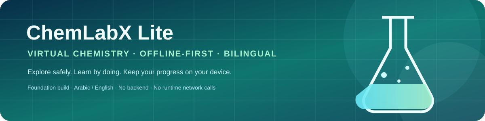
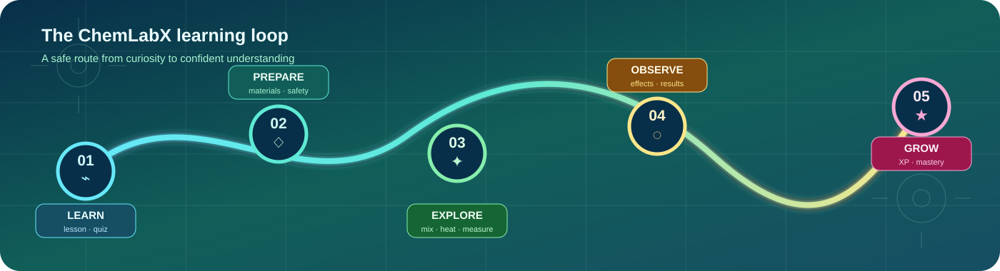
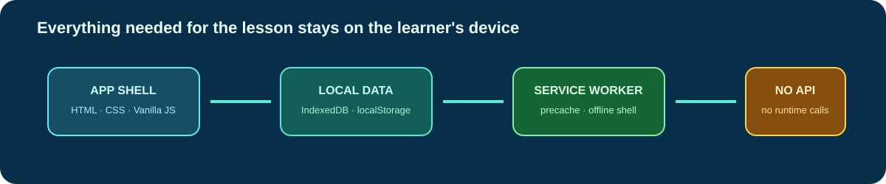

<div align="center">



<br>

<a href="https://dev-kaido.github.io/ChemLabX_Lite/"></a>
<a href="https://github.com/Dev-KAIDO/ChemLabX_Lite"></a>
<a href="#التحقق"></a>
<a href="#privacy--offline-first"></a>

# ChemLabX Lite

### Virtual chemistry learning — built to explore safely, even without the internet

<p><strong>معمل كيمياء افتراضي عربي / إنجليزي، يعمل محليًا كتطبيق PWA، ويحوّل التعلم من قراءة النتيجة إلى تجربة وملاحظة وفهم.</strong></p>

</div>

---

## جرّبه مباشرة

<div align="center">

<a href="https://dev-kaido.github.io/ChemLabX_Lite/"></a>

<br>

<sub>لا يحتاج إلى تنزيل. التقدم يُحفظ في متصفح كل زائر على حدة.</sub>

</div>

## رحلة التعلم

ChemLabX Lite لا يعرض معلومة فقط؛ بل يبني حلقة تعلم قصيرة: يتعلم الطالب، يجهز المواد بأمان، يستكشف التفاعل، يلاحظ النتيجة، ثم يعود بخبرة أفضل.



<div align="center">

<a href="#المعمل"></a>
<a href="#المعمل"></a>
<a href="#المعمل"></a>
<a href="#المعمل"></a>
<a href="#المعمل"></a>

</div>

### بروتوكول التجربة

| المرحلة | ما يحدث داخل المعمل | ما يخرج به المتعلم |
| --- | --- | --- |
| **Learn** | درس قصير وسؤال يختبر الفكرة قبل التجربة | فرضية أولية، لا تخمين عشوائي |
| **Prepare** | اختيار المواد وقراءة تنبيه السلامة | تجربة جاهزة ضمن حدود واضحة |
| **Explore** | خلط، تسخين، ترشيح، وقياس | ملاحظة قابلة للمقارنة |
| **Observe** | قراءة أثر اللون والحرارة والغاز والنتائج | تفسير مبني على دليل مرئي |
| **Grow** | XP، إنجازات، وإعادة المحاولة | تقدم محفوظ وخبرة تراكمية |

> **التصميم التعليمي:** لا نُخفي الخطأ؛ نجعل التجربة قابلة للمحاولة والمراجعة، مع إبقاء السلامة والسياق ظاهرين قبل النتيجة.

## خريطة README

<div align="center">

<table>
<tr>
<td align="center"><a href="#المعمل"><br><strong>🧪 المعمل</strong></a></td>
<td align="center">➜</td>
<td align="center"><a href="#لماذا-lite"><br><strong>🎯 Lite</strong></a></td>
<td align="center">➜</td>
<td align="center"><a href="#privacy--offline-first"><br><strong>🔒 الخصوصية</strong></a></td>
<td align="center">➜</td>
<td align="center"><a href="#التشغيل"><br><strong>⚙️ التشغيل</strong></a></td>
<td align="center">➜</td>
<td align="center"><a href="#التحقق"><br><strong>✅ التحقق</strong></a></td>
</tr>
</table>

<sub><strong>Explore the lab → understand the foundation → protect the learner → run it → verify it.</strong></sub>

</div>

## المعمل

<table>
<tr>
<td width="25%" align="center"><h2>🧫</h2><strong>تجارب تفاعلية</strong><br><sub>اسحب، اخلط، سخّن، رشّح، وقِس</sub></td>
<td width="25%" align="center"><h2>🛡️</h2><strong>سلامة أولًا</strong><br><sub>تحذيرات قبل التفاعلات الخطرة</sub></td>
<td width="25%" align="center"><h2>📚</h2><strong>تعلم وقيّم</strong><br><sub>دروس، اختبارات، XP وإنجازات</sub></td>
<td width="25%" align="center"><h2>🌐</h2><strong>للجميع</strong><br><sub>عربي / English · RTL · وصولية</sub></td>
</tr>
</table>

### ماذا يستطيع الطالب أن يفعل؟

- يفتح درسًا قصيرًا ثم يختبر فهمه بتغذية راجعة فورية.
- يختار المواد من الرف ويسحبها إلى منطقة التجربة.
- يخلط ويسخن ويرشح ويقيس مع محاكاة أثر حراري ولوني وغازي.
- يرى قواعد السلامة قبل تنفيذ التفاعل.
- يتابع XP والإنجازات والملف الشخصي محليًا.
- يبدّل بين العربية والإنجليزية مع دعم RTL كامل.

### أدوار جاهزة للتجربة

| الدور | تجربة الاستخدام |
| --- | --- |
| **طالب** | الدروس، المعمل، الاختبارات، XP والإنجازات |
| **معلم** | استكشاف المحتوى ومصفوفة الصلاحيات |
| **مدير** | تجربة الإدارة المحلية والتحكم في الوصول |

## لماذا Lite؟

`Lite` هنا تعني **Foundation build**: نسخة أساسية صغيرة وواضحة تثبت التجربة قبل إضافة خادم أو مزامنة أو فصول مشتركة.

- Frontend فقط باستخدام Vanilla JavaScript.
- لا يوجد Backend أو قاعدة بيانات سحابية.
- البيانات محفوظة في المتصفح عبر `IndexedDB` و`localStorage`.
- المحتوى التعليمي `content-v1`: 6 دروس، 20 سؤالًا، و14 تجربة.
- لا توجد مزامنة متعددة الأجهزة أو واجبات محفوظة على خادم.
- صفر طلبات وقت التشغيل إلى Google Fonts أو CDN.

## Privacy & offline-first



التصميم مبني على مبدأ واضح: **التجربة التعليمية لا تحتاج إلى إرسال تقدم الطالب إلى خادم حتى تعمل.**

- App shell والبيانات والخطوط محلية.
- Service Worker `chemlabx-v14` يقوم بالتخزين المسبق.
- التقدم محفوظ في متصفح كل مستخدم بشكل مستقل.
- لا توجد اتصالات شبكة وقت التشغيل للتجارب أو المحتوى.
- مسح بيانات المتصفح يعني مسح التقدم المحلي؛ لا توجد نسخة سحابية مخفية.

> هذه نسخة تعليمية محلية، وليست نظامًا طبيًا أو مرجعًا علميًا نهائيًا. المحتوى تم التحقق من بنيته واتساق إحالاته، وليس اعتمادًا علميًا خبيرًا لكل نص.

## التشغيل

### جرّب النسخة المنشورة

افتح: <https://dev-kaido.github.io/ChemLabX_Lite/>

يمكن تثبيتها كتطبيق من قائمة المتصفح عبر **Install / Add to Home Screen**.

### شغّلها محليًا

يمنع المتصفح تشغيل Service Worker من `file://`، لذلك استخدم خادمًا محليًا.

#### Windows / PowerShell

```powershell
powershell -NoProfile -ExecutionPolicy Bypass -File test/server.ps1 -Port 8765
```

ثم افتح:

```text
http://127.0.0.1:8765/index.html
```

#### Windows / macOS / Linux عبر Python

```bash
git clone https://github.com/Dev-KAIDO/ChemLabX_Lite.git
cd ChemLabX_Lite
python -m http.server 8765
```

## حسابات العرض المحلية

| الدور | البريد | كلمة المرور |
| --- | --- | --- |
| طالب | `student@chemlabx.com` | `student123` |
| معلم | `teacher@chemlabx.com` | `teacher123` |
| مدير | `admin@chemlabx.com` | `admin123` |

> هذه الحسابات للعرض المحلي فقط. لا تستخدمها في نشر حقيقي.

## التحقق

الحالة الحالية:

<div align="center">


</div>

```powershell
# 143 فحصًا في online / offline×2 / preload
# + 10 صفحات + Service Worker cold-start
powershell -NoProfile -ExecutionPolicy Bypass -File test/verify.ps1

# مدققات مستقلة
python test/validate_content.py
python test/validate_chemistry.py
python test/validate_changejournal.py
python test/validate_authorization.py
```

## البنية

```text
ChemLabX_Lite/
├── index.html … admin.html        # 10 صفحات للتجربة
├── css/                            # theme tokens + styles + local fonts
├── js/core/                        # i18n, auth, db, ui, versions, dataport
├── js/domain/                      # chemistry, safety, education, authorization
├── js/data/                        # 185 materials, 28 reactions, content packs
├── js/lab/                         # engine, bench, effects, particles, shelf
├── js/pages/                       # منطق صفحات التطبيق
├── fonts/                          # 16 woff2 محليًا + licenses
├── test/                           # harness, validators, server, verification
├── docs/architecture/              # قرارات ومخططات معمارية
└── assets/                         # صور README المحلية الخاصة بالمشروع
```

## الإصدارات المثبتة

```text
SCHEMA_VERSION=2
CHEMISTRY_DATA_VERSION=validated-v1
CONTENT_VERSION=content-v1
APP_VERSION=4.0.0-foundation
```

## حدود النسخة الحالية

- المحتوى التعليمي ليس اعتمادًا علميًا نهائيًا لكل سؤال.
- لا توجد مزامنة بين الأجهزة.
- لا توجد فصول أو واجبات محفوظة على خادم.
- مسح بيانات المتصفح يمسح التقدم المحلي.
- لا يوجد Backend، ولا تُرسل بيانات المستخدم إلى خادم.

## الطريق القادم

- توسيع حزم التجارب والمحتوى مع الحفاظ على التحقق البنيوي.
- تحسين تفسير النتائج والتغذية الراجعة للطالب.
- إضافة تجارب أكثر مع قواعد سلامة واضحة.
- الحفاظ على الأداء والوصولية والعمل دون اتصال قبل إضافة أي تعقيد جديد.

## الترخيص

لم يُحدَّد ترخيص للمشروع بعد — جميع الحقوق محفوظة. خطوط Cairo وInter وRoboto Mono مدرجة بتراخيصها في [`fonts/LICENSE.txt`](fonts/LICENSE.txt) وفق SIL OFL 1.1.

---

<div align="center">

<a href="https://github.com/Dev-KAIDO"></a>
<a href="https://github.com/Dev-KAIDO/Eng_KAIDO"></a>

<br><br>

**Learn safely · Experiment locally · Understand deeply**

</div>
